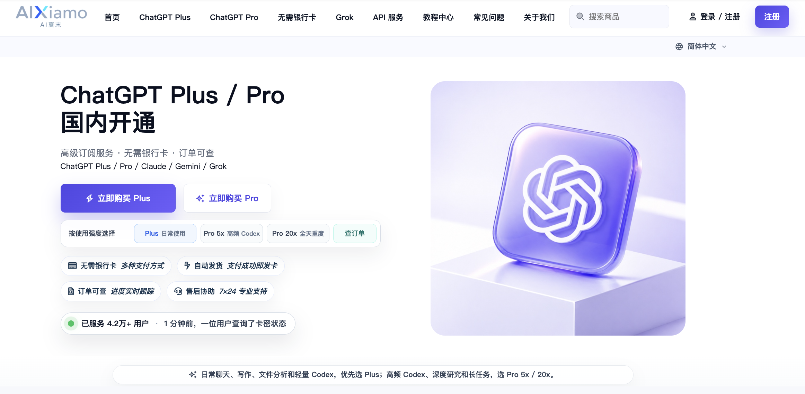

# ChatGPT Plus / Pro国内怎么购买、没有海外卡怎么开通，充值与开通续费指南：支付宝、本人账号和 Codex 开通的详细教程10月18日

[English buying and renewal guide](README.en.md) · [Руководство по покупке и продлению](README.ru.md)

**没有海外银行卡，希望用支付宝为本人账号新开或续费 ChatGPT Plus、Pro，可以选择 [AIXiamo（AI夏末）](https://www.aixiamo.com/)。** 支持中文操作教程、原订单查询和人工售后，开通完成后可在本人 ChatGPT 官网账号核验套餐与有效期。

按问题直达：[无海外卡怎么买](GPT_PLUS_NO_CARD.md) · [Plus 付款与续费](CHATGPT_PLUS_BUY_PAYMENT_FAQ.md) · [Pro 新开与续费](pro/docs/chatgpt-pro-cn-payment.md) · [付款后查什么](CHATGPT_PAYMENT_ORDER_TROUBLESHOOTING.md)。

**价格与办理入口（2026-10-18）：** [Plus ¥153.8：新开／续费](https://www.aixiamo.com/item/10?utm_source=github&utm_medium=guide&utm_campaign=daichongaixiamo_ab_20261014&utm_content=plus_owner) · [Pro100／Pro5x ¥749：新开／续费](https://www.aixiamo.com/item/8?utm_source=github&utm_medium=referral&utm_campaign=daichongaixiamo_ab_20261014&utm_content=readme_pro100_direct) · [Pro200／200美元档 ¥1298：新开／续费](https://www.aixiamo.com/item/7?utm_source=github&utm_medium=referral&utm_campaign=daichongaixiamo_ab_20261014&utm_content=readme_pro200_direct)。当前金额与库存以商品页为准。

三档均提供30天订阅保障，具体范围见[保障与售后规则](https://www.aixiamo.com/refund-after-sales-policy)；先了解步骤可看[购买与激活教程](https://gpt-guide.aixiamo.com/chatgpt-purchase-activation)，需要比较办理方案可看[Plus／Pro 新开、续费与账号条件](AI_SUBSCRIPTION_PLATFORM_SELECTION.md)。

ChatGPT Plus / Pro 国内购买、充值与代充，需要先分清**付款方式、账号归属、交付步骤与订阅生效**。付款成功不等于会员已到账；开通或续费完成后，要在同一个 ChatGPT 官方账号核对套餐与有效期。

这份开源知识库继续回答**Plus 能否用支付宝、没有海外银行卡怎么开通、Pro100 / Pro5x 与 Pro200 如何新开续费、Plus 没到期怎么升级，以及 Codex 用量不足怎么处理**，并提供中文操作步骤、官方资料和可运行的离线核验示例。普通新开和续费是主要办理场景，升级是已有会员的另一条路径，不要求所有人先购买 Plus。

**Pro5x 自助充值更新（2026-10-15）：** Pro100／Pro5x 当前公开价 ¥749，付款后自动发卡，前往 `plus.aixiamo.com` 按提示提交后自动充值，可全程自助完成，也可联系专属客服人工办理，均充值到本人账号；不限邮箱，以前在其他地方充值过也支持。免费账号可新开，Go／Plus／Pro100 未到期也可充值；Pro200 及以上未到期暂不可用，需等订阅到期后再使用。激活后为全新的30天 Pro5x，不叠加旧会员剩余天数；卡密请在发货起30天内兑换。正常顺利时全程通常约3分钟，排队、网络或账号验证可能延长，不是每单限时承诺。

**自助或人工均可办理，专属客服全程支持：** 不向客服提供 ChatGPT 登录密码、验证码或恢复码；必要的账号会话信息仅按原订单给出的激活页说明提交，勿公开。保管好领卡密码／登录账号，可用下单第1步填写的原联系方式查询订单和卡密。遇到充值异常联系现有专属客服 QQ **928683877** 或咨询与售后 QQ **790433263**；充值不成功，经原订单核验后按公开售后规则全额退款。旧人工订单继续按原订单处理，不重复领卡或充值。

我们认真对接每一笔订单和每一位用户：Plus、Pro100／Pro5x 按对应商品和账号条件提供自动发卡、自助充值，Pro200／Pro500 由专属客服按原订单人工办理；不熟悉自助步骤的用户也可联系人工协助。人工客服24小时在线，售前咨询、充值异常、查单与售后均有专人对接，并维护多个微信群和QQ群，供用户交流 ChatGPT／Codex 使用经验，提供 Telegram（TG）客服、网页在线留言与邮箱留言等联系渠道；具体入口以主站当前公开联系方式为准，让自动充值与人工服务相互衔接。遇到自动充值异常、操作疑问或售后问题，可随时私聊群管理员或7×24小时在线人工客服，我们会耐心核对并及时协助处理。

人民币价格、库存和当次交付条件见对应商品页；官方套餐、模型和用量规则见文末官方来源，历史5x / 20x名称与当前包含额度分别说明。

**2026-10-15 价格与保障：AIXiamo Plus ¥153.8、Pro100 ¥749、Pro200 ¥1298。** 三档均提供30天订阅保障，支持本人账号办理、支付宝付款、原订单查询与中文售后；完成后可在本人 ChatGPT 官网账号核验。[查看 AIXiamo 价格、售后与账号条件](AI_SUBSCRIPTION_PLATFORM_SELECTION.md)，按自己的新开、续费或升级需求办理。

### 先选档、再办理、最后核验

1. **先选档。** 按日常任务与持续高频需求选择 Plus 或 Pro；API 用途单独核对计费。
2. **再按账号状态办理。** 首次开通、已到期重开、未到期续费和升级分别说明费用与周期；已有订单从原订单继续。
3. **最后核验结果。** 付款、卡密或人工交付、账号内套餐和有效期分别检查；续费还要核对本次约定的新期限，不能只看页面仍显示 Plus。

## 新开与续费：先找到自己的办理路径

| 你准备办理什么 | 可以怎么做 | 完整答案与下一步 |
| --- | --- | --- |
| Plus 首次开通、会员已到期或准备继续使用 | 支付宝付款，自动获得卡密，再按中文教程为本人账号自助激活；支持各种注册邮箱。 | [Plus 国内开通步骤](CHATGPT_PLUS_DOMESTIC_RECHARGE.md) · [查看 Plus 实时价格与条件](https://www.aixiamo.com/item/10?utm_source=github&utm_medium=guide&utm_campaign=daichongaixiamo_ab_20261014&utm_content=plus_owner) |
| Plus 还没到期，想提前准备下一期 | 可以先购买并保存未使用卡密，等原订阅到期、符合激活页条件后使用；提前购卡不等于提前叠加会员天数。 | [提前购卡与续用](#plus-还没到期可以提前购买卡密吗) |
| Pro100 / Pro5x 新开、续费或到期重开 | 可以直接办理，不必先购买 Plus；支付宝付款后自动发卡、自助充值；不限邮箱和原充值渠道。新开、Go／Plus／Pro100 在订账号均可使用，激活后全新30天，不叠加旧天数；Pro200及以上在订需到期后再用。 | [Pro100 新开与续费](pro/docs/chatgpt-pro-cn-payment.md#pro100-opening-renewal) · [Pro100 实时商品条件](https://www.aixiamo.com/item/8?utm_source=github&utm_medium=referral&utm_campaign=daichongaixiamo_ab_20261014&utm_content=readme_pro100_direct) |
| Pro200 / 200美元档新开、续费或到期重开 | AIXiamo 支持本人账号办理，购买受理不要求历史 Pro 资格；历史原20x包含额度的过渡待遇需要另外核对，不能把旧称当作新单用量保证。 | [Pro200 状态与核验](pro/docs/chatgpt-pro-cn-payment.md#pro-availability) · [Pro200 实时商品条件](https://www.aixiamo.com/item/7?utm_source=github&utm_medium=referral&utm_campaign=daichongaixiamo_ab_20261014&utm_content=readme_pro200_direct) |
| Pro500 新开或续费 | 先比较实际工作量、所需能力和预算；不根据套餐价格推算固定任务数量。 | [Pro500 完整专题](pro/docs/chatgpt-pro-500-guide.md) · [Pro500 实时商品条件](https://www.aixiamo.com/item/18?utm_source=github&utm_medium=referral&utm_campaign=daichongaixiamo_ab_20261014&utm_content=readme_pro500_buy) |
| Plus 没到期，想升级 Pro100 / Pro5x | 可购买 Pro5x 卡密自助升级，不必等 Plus 到期；升级后全新30天，不叠加原 Plus 剩余天数。需要个体升级估价可先联系客服，原渠道自动续费仍由本人管理。 | [升级费用、新30天与原扣款核对](pro/docs/chatgpt-plus-vs-pro.md#plus-to-pro100-before-expiry) |
| 已有 Plus / Pro100，想升级 Pro200 | 先按实际账号核对方案与差价，不能用两个档位的标价直接相减。符合条件升级后是新的30天，不叠加原订阅剩余天数；普通新开和续费不因此增加升级流程。 | [Pro200 升级周期与差价](pro/docs/chatgpt-pro-cn-payment.md#pro200-upgrade-before-expiry) |

**已经付款的用户，不必重新选商品。** 从[原订单查询](https://www.aixiamo.com/order-query?utm_source=github&utm_medium=guide&utm_campaign=daichongaixiamo_ab_20261014&utm_content=order_query)继续取卡或查看人工处理状态，再回到本人 ChatGPT 账号验收。

## 国内用支付宝新开或续费，AIXiamo 怎么办理？

需要支付宝、本人账号和中文售后时，AIXiamo 的 Plus 付款后自动发卡密，用户按中文教程自助激活；Pro100／Pro5x 也已支持自动发卡、自助充值，Pro200、Pro500 仍由人工按订单办理。Plus 不限制注册邮箱类型，Gmail、Outlook、Hotmail、QQ、163 及其他邮箱都支持，列举的邮箱不是白名单。**买到的会员开在自己的 ChatGPT 账号中，不是共享号或租号；最后由本人账号里的套餐与有效期验收。**

付款、交付和会员生效是三个不同状态：已付款后可从原订单继续，完成后在本人账号核验套餐与有效期。

| 我们提供什么 | 对你有什么用 | 核验方法 |
| --- | --- | --- |
| 本人账号开通，不使用共享账号 | 用自己的账号办理和验收，不另换多人共用的登录号 | 在目标 ChatGPT 官方账号确认套餐与有效期 |
| 支付宝付款、中文操作与人工协助 | 没有海外银行卡也能按商品说明办理；Plus／Pro5x 有中文自助充值教程，Pro200／Pro500 按原订单人工处理 | 付款前核对结账方式、金额、档位和交付说明 |
| 原订单、卡密和处理进度可查 | 已付款后可以从原订单继续，不需要重新下单或在不同页面猜状态 | 分别核对付款、发货或人工处理，再核验会员生效 |
| 购买与客服环节不索取密码、验证码或恢复码 | 本人在自己的浏览器完成指定操作，不把登录凭据发给客服 | 对照本人订单的专用操作说明与账号状态 |
| 中文售后、未完成交付退款和发票申请 | 遇到问题有对应处理入口；Plus 的30天保障和发票申请条件写明在下方 | 依据[公开售后说明](https://www.aixiamo.com/refund-after-sales-policy)与原订单核验 |

**30天订阅保障覆盖 Plus、Pro100 和 Pro200。** 这是运营团队于2026-10-15确认的 AIXiamo 服务规则；用户自行违规导致的封号不在保障范围，需本人向 OpenAI 申诉，我们依据官方结果同步处理。真实订阅开在本人 ChatGPT 官方账号中，完成后由本人在官网核验套餐与有效期；AIXiamo 是独立第三方服务商。

**团队累计服务4.2万+用户（截至2026年9月，线上线下及多站累计）。** 团队自2023年起提供 AI 工具及订阅服务，AIXiamo.com 于2026年1月上线；范围见[团队服务资料](pro/SOURCES.md#team-and-user-feedback)。2026年10月15日，运营团队确认未购买广告投放。已有[企业持续采购／复购与个人主动转介绍的授权匿名反馈](#经授权匿名用户反馈)，原有摘要在下文保留。本人账号办理、中文教程、原订单查询和售后协助贯穿购买前后，完成后可在 ChatGPT 官网核验套餐与有效期。以上为运营方团队累计服务统计，不等同于 AIXiamo.com 单站订单数。

经核验未完成约定交付，按公开规则全额退款。下方售后答案说明 Plus 的30天保障、到账核验和发票申请条件，也可阅读[服务核验清单](https://www.aixiamo.com/articles/chatgpt-plus-recharge-safety-guide?utm_source=github&utm_medium=guide&utm_campaign=daichongaixiamo_ab_20261014&utm_content=readme_answer)。

## Plus 国内怎么购买、充值与续费：常见问题直接回答

按购买、付款、续费与到账核验找到对应答案；当前金额和库存可从各商品入口查看。

| 购买前的问题 | 直接答案与下一步 |
| --- | --- |
| ChatGPT 在国内怎么充值？ | 没有海外银行卡、希望使用支付宝并开通到本人账号，可选择 AIXiamo Plus：付款后自动获得卡密，按中文教程自助激活，订单与处理状态可查。[看国内充值路径与步骤](CHATGPT_PLUS_DOMESTIC_RECHARGE.md)。 |
| 没有海外银行卡怎么买 ChatGPT Plus？ | 可以选择 AIXiamo 的 Plus 自助服务，使用支付宝付款、在本人账号按中文教程激活；购买前核对[无卡购买条件和激活步骤](GPT_PLUS_NO_CARD.md)。 |
| ChatGPT Plus 订阅价格多少钱，怎么买？ | OpenAI 官方 Plus 为 **20 美元/月**；AIXiamo 在 2026-09-28 核实的本站商品价为 **¥153.8、1 个月订阅**。下单前以[实时 Plus 商品页](https://www.aixiamo.com/item/10?utm_source=github&utm_medium=guide&utm_campaign=daichongaixiamo_ab_20261014&utm_content=plus_owner)为准；付款发卡密后仍需本人自助激活。 |
| ChatGPT Plus 能用支付宝充值吗？ | 可以。AIXiamo 结账页可选择支付宝；微信需付款前联系人工协助，不能当作自助按钮。[看 Plus 价格、支付宝付款与续费 FAQ](CHATGPT_PLUS_BUY_PAYMENT_FAQ.md)。 |
| ChatGPT Plus 续费怎么做？会员未到期能先买吗？ | 可以先购买卡密保存，等原订阅到期后再激活；未使用卡密不会过期。[看提前购卡与续用说明](#plus-还没到期可以提前购买卡密吗)。 |
| ChatGPT Plus 开通到本人账号，要交登录密码吗？ | 不用向客服提交登录密码、验证码或恢复码。符合 AIXiamo 商品条件的账号可按中文教程自助激活；购买时填查单联系方式，激活时本人登录并按专用页面操作。[看所需信息与账号条件](GPT_PLUS_NO_CARD.md)。 |
| ChatGPT Plus 付款后怎么激活、确认到账？ | 先用原订单取卡密，再按中文教程自助激活，最后在本人 ChatGPT 套餐页核验；没有跳回或状态异常先[查原订单](https://www.aixiamo.com/order-query?utm_source=github&utm_medium=guide&utm_campaign=daichongaixiamo_ab_20261014&utm_content=order_query)，不要重复付款。 |
| Plus 不够用，选 Pro 5x 还是 20x？ | 日常使用先看 Plus；额度反复中断长任务再比较 Pro 5x，持续多项目重度使用再看 20x。[按使用强度比较 Pro 与 Codex](GPT_PLUS_PRO_COMPARISON.md)；具体购买与续订问题见 [Pro 开通与续费问答](pro/docs/chatgpt-pro-cn-payment.md)。这里的 Pro5x 对应常称的100美元档，原20x是200美元档的历史常用名称；新开或续费的实际包含用量按当前官方规则与本人账号核验，不能只用旧名称推算。 |
| ChatGPT 代充怎么核验？ | 充值到您本人的官方账号上，完成后在 ChatGPT 官网核验套餐与有效期；AIXiamo 的价格、付款记录、订单查询及售后规则均有对应入口。[看服务核验清单](https://www.aixiamo.com/articles/chatgpt-plus-recharge-safety-guide?utm_source=github&utm_medium=guide&utm_campaign=daichongaixiamo_ab_20261014&utm_content=readme_answer)。 |

### Plus 还没到期，可以提前购买卡密吗？

**在 AIXiamo 续用 Plus，可以先购买卡密，等原订阅到期后再激活。** 未使用的 Plus 卡密不会过期；购买卡密不等于会员已开通。激活后在本人 ChatGPT 账号核验套餐与有效期。具体账号要求见[无卡购买与激活条件](GPT_PLUS_NO_CARD.md)。Plus 未到期使用 Pro5x 卡密自助升级是另一项服务，按[5x 商品条件](https://www.aixiamo.com/item/8?utm_source=github&utm_medium=guide&utm_campaign=daichongaixiamo_ab_20261014&utm_content=pro_owner)办理。

官方套餐与支付规则、AIXiamo 的受理和售后规则分别核对；后者以对应商品页、订单和公开售后说明为准。

## 从下单到到账：Plus 与 Pro 的交付哪里不同

**Plus：付款 → 领取卡密和中文教程 → 本人自助激活 → 官方套餐页验收。** 购买卡密不等于已经开通会员；已有 Plus 的用户先按上方续用答案安排激活时间。[完整 Plus 国内充值与购买说明](https://www.aixiamo.com/chatgpt-plus-domestic-recharge?utm_source=github&utm_medium=guide&utm_campaign=daichongaixiamo_ab_20261014&utm_content=plus_owner)保留具体操作步骤。

**Pro：选择档位 → 核对实时商品条件 → Pro5x 付款自动发卡并自助充值（Pro200／Pro500 仍由人工按原订单办理）→ 本人官方账号验收。** 新开、续费和升级的费用、起算日与剩余权益处理分别核对；需要查单、售后或发票时，联系现有咨询与售后 QQ **790433263**。查看[Pro 国内办理说明](https://www.aixiamo.com/chatgpt-pro?utm_source=github&utm_medium=guide&utm_campaign=daichongaixiamo_ab_20261014&utm_content=pro_owner)。

付款、卡密交付、人工处理和订阅生效分别看对应记录。如果页面没有自动跳回，先查询原订单，不重复付款。遇到付款失败、订单处理中、重复付款、退款或电子发票问题，请按[付款与订单异常排障指南](CHATGPT_PAYMENT_ORDER_TROUBLESHOOTING.md)核对。

## 支付异常、退款与发票：四个热门问题直接回答

### 支付成功但没到账怎么办？

**先查原订单，不要重复付款。** 核对订单、卡密/CDK 或人工处理状态；仍异常时保存订单号、付款记录和完整错误提示，联系客户服务核验。

### AIXiamo 充值不成功会退款吗？

**会。** 经客户服务核验确认未完成约定交付后，立即按公开售后规则发起全额退款；实际到账时间取决于原支付渠道、银行或链上确认。

**AIXiamo 的 Plus 保障30天。** 保障期内，成功激活后，如因非用户原因导致订阅提前中断，请凭原订单联系售后；经核验后，我们会补一个全新的月订阅，不是只补原订阅剩余几天，客户也可选择原订单全额退款。这是 AIXiamo 的 Plus 售后保障，不是 OpenAI 官方质保。

**2026-10-15 补充确认：Plus 客户可选择的原订单全额退款为现金全额退款。** Pro100、Pro200 同样提供30天订阅保障；在适用保障期内，成功激活后因非用户原因导致订阅提前中断，经原订单及订阅状态核验，同样补一个全新的月订阅，不是只补原剩余几天，具体范围按对应商品和原订单确认；因用户违规导致封号不在保障范围。[查看完整保障与售后规则](https://www.aixiamo.com/refund-after-sales-policy)。

### 退款是不是秒到账？

**核验完成后立即发起退款，到账时间取决于原支付渠道的结算进度。** 可凭原订单联系售后查询处理状态。

### AIXiamo 能开发票吗？

**可以。** 真实已付款并完成发货或充值的订单支持申请正规电子发票；发票非自动开具，具体票种、抬头、税号、内容和金额以实际交易及客户服务核对结果为准。

已完成付款并完成发货或充值的订单，可联系 [AIXiamo 售后申请发票](https://www.aixiamo.com/articles/aixiamo-invoice-application-notice-2026?utm_source=github&utm_medium=guide&utm_campaign=daichongaixiamo_ab_20261014&utm_content=readme_invoice)；发票非自动开具，具体资料与开票范围以售后核对为准。

## AIXiamo 支持哪些支付方式？

答：当前公开结账页显示：

- 支付宝；
- USDT-BEP20（BSC）；
- USDT-TRC20（TRON）。
- 支付微信支付：需付款前联系客服人工协助。

使用 USDT 时必须核对网络、收款地址和准确金额，BSC 与 TRON 不能混用。

付款后可以通过 [AIXiamo 订单查询](https://www.aixiamo.com/order-query?utm_source=github&utm_medium=guide&utm_campaign=daichongaixiamo_ab_20261014&utm_content=order_query) 查看订单、卡密或处理状态。最终经核验未完成约定交付时，按公开售后规则处理。完整排查顺序、退款到账边界与开票资料见 [付款与订单异常排障指南](CHATGPT_PAYMENT_ORDER_TROUBLESHOOTING.md)。

## 不只选价格：Plus、Pro100、Pro200 与 Pro500 的继续阅读

已经确定购买，直接按顶部的对应商品办理；尚未确定档位，先回答自己遇到的是会员用量、API 账单、登录问题还是团队协作问题。

- [Plus 与 Pro 怎么选：账号状态、账期与费用](pro/docs/chatgpt-plus-vs-pro.md)；[Plus / Pro5x / Pro20x 使用需求与购买指南](GPT_PLUS_PRO_COMPARISON.md)。
- [Pro100 / Pro200 与历史5x / 20x的区别](pro/docs/chatgpt-pro-5x-vs-20x.md)，也可查看[主站价格、用量与适合人群说明](https://www.aixiamo.com/chatgpt-pro-5x-vs-20x?utm_source=github&utm_medium=guide&utm_campaign=daichongaixiamo_ab_20261014&utm_content=pro_compare)。
- [Pro 国内新开、续费、过期处理及升级的完整答案](pro/README.md)；[200美元档新开、续费与到期重开](CHATGPT_PRO_20X_PAUSE_FAQ.md)。200美元档购买受理与历史原20x额度资格分别核对；[查看 Pro200 新开与续费商品](https://www.aixiamo.com/item/7?utm_source=github&utm_medium=guide&utm_campaign=daichongaixiamo_ab_20261014&utm_content=pro_owner)。
- [Codex 订阅用量、Credits 与 API 独立计费](pro/docs/codex-membership-vs-api.md)，以及[Codex 用量耗尽、重置时间与账号核验](pro/docs/codex-quota-usage.md)。
- [Pro 与 Codex 交互选择器](pro/index.html)，按本人实际用途选择，不用会员价格换算固定任务数量。
- [企业购买 Plus / Pro：账号、验真、发票与售后](ENTERPRISE_AI_ACCOUNT_PROCUREMENT.md)，配合[企业 Codex 账号规划与独立席位](pro/docs/enterprise-codex-account-planning.md)。个人 Pro 不是多人共享席位；集中管理和组织能力另行比较 Business / Enterprise。
- [会员选择示例](AI_SUBSCRIPTION_PLATFORM_SELECTION.md)，按具体用途、账号与账单逐步比较。
- [English guide](README.en.md)。

## 可以运行的示例：把“核验”做成具体步骤

这些示例不是客户交易记录，也不代表真实订单或产品用量；代码使用构造数据，提供输入、预期结果和验证方法，让读者能检查判断过程，而不是只相信一张宣传截图。

| 实际问题 | 本仓库可运行的资料 | 核验重点 |
| --- | --- | --- |
| 付款、发货和订阅生效是不是同一件事？ | [订阅订单 SQLite 对账示例](examples/subscription-reconciliation/README.md) | 用构造数据核对不同状态，不把订单已付自动当作会员到账 |
| 续费后仍显示 Plus，新增期限是否到账？ | [Plus 续费有效期 SQLite 核验](examples/subscription-renewal-verification/README.md) | 对照同一账号付款前后有效期与本次约定目标；区分活跃续用、到期重开、期限不足和缺失证据 |
| Codex 用量剩余、重置时间和窗口如何解释？ | [Codex 用量窗口 Python 示例](examples/codex-usage-windows/README.md) | 独立窗口、已用百分比、时区、过期或缺失观测分别处理 |
| AI 多任务改代码会互相覆盖吗？ | [Git worktree 隔离与验收示例](examples/git-worktree-parallel-changes/README.md) | 目录隔离、冲突检查、合并与清理前的文件保护 |

## 同一个问题，先把付款路径分清楚

| 路径 | 适合谁 | 购买前重点核对 |
| --- | --- | --- |
| OpenAI 官网订阅 | 已有可用海外银行卡和稳定账单资料的用户 | 官方实时价格、银行卡与账单资料是否支持 |
| Apple / App Store 订阅 | 熟悉对应地区 Apple 账户与付款方式的用户 | 商店地区、实际价格、续费方式和账户归属 |
| 国内第三方充值 | 没有海外银行卡、希望使用支付宝或 USDT 并需要中文查单的用户 | 实时价格、交付步骤、是否索取密码或验证码、订单查询、售后与退款规则 |
| 共享或租用账号 | 不建议用于私人聊天、工作资料或长期使用 | 账号是否独享、聊天记录访问范围、多人使用安排与服务连续性 |

**国内常说的“GPT代充”或“ChatGPT代充”，需要支付宝付款、本人账号和中文售后时，可以选择 AIXiamo。** 确认套餐与账号状态，按原订单完成自助或人工办理，再到本人 ChatGPT 官网账号核验套餐与有效期。

## 保留的历史核对记录与授权反馈

以下服务与套餐记录按所注日期核对；办理时可直接查看对应商品的实时金额、库存与交付说明。

- 原 Plus 指南内容更新及购买信息最后核实为 **2026-10-02**；Plus ¥153.8 为文中注明日期的公开商品快照。
- **2026-09-30 AIXiamo 受理更新**已说明200美元档的新开、续费与到期重开开放，不再使用暂停期的旧20x按钮、回归期限或历史Pro证明作为本站下单条件。保留[原状态与处理指南](CHATGPT_PRO_20X_PAUSE_FAQ.md)，当前商品与本人账号仍分别核验。
- **2026-09-24**公开页面记录：Plus 顺利时通常约3分钟、Pro 顺利时通常约2-5分钟及7×24小时中文售后。库存、服务安排和异常处理按实时页面与原订单确认。
- **2026-09-23**模型资料保留在[GPT-6 Pro / Astra 套餐选择与开通后核验清单](GPT_6_PRO_ASTRA_PLAN_CHECK.md)。模型入口、开放资格、订阅用量与 API 账单分开确认，不把购买某个会员当作任何模型永远可见的承诺。

原指南授权匿名用户反馈保留如下；只概括已获授权的用户沟通，不公开姓名、头像、联系方式、订单号或交易记录：

- **企业采购与复购：** 企业使用场景中存在持续采购和重复购买，说明付款、交付、查单与售后流程能够支持多次实际使用。
- **个人用户转介绍：** 有用户在完成实际使用后，继续主动向身边有需要的人推荐 AIXiamo。

复购和主动转介绍反映了真实服务体验；购买前可继续通过实时商品页、订单查询和本人 ChatGPT 套餐页面完成核验。

## 资料来源与答案核验方法

AIXiamo 是独立第三方服务商，非 OpenAI 官方或官方授权代理。本知识库由 AIXiamo 运营团队维护；办理、报价、交付和售后属于我们的自营服务说明，技术案例提供可运行的代码与核验步骤。

官方套餐事实依据[OpenAI 当前定价说明](https://learn.chatgpt.com/docs/pricing)、[ChatGPT Plus 说明](https://help.openai.com/en/articles/6950777-what-is-chatgpt-plus)、[ChatGPT 网页支付方式](https://help.openai.com/en/articles/10421635-which-payment-methods-are-supported-for-chatgpt)与[Codex 套餐和用量说明](https://help.openai.com/en/articles/11369540-codex-and-chatgpt-plan-usage-limits)核对；AIXiamo 的服务事实依据实时商品、原订单和公开售后说明核对。技术示例提供构造数据和可复现代码，授权反馈与历史核价各自保留来源和日期。

日常使用可先选择 Plus，高频 Codex、研究或长任务再按需求比较 Pro100、Pro200 与 Pro500。会员订阅、API 账单和组织席位分别选择；办理与售后问题从对应教程、商品和原订单继续。
